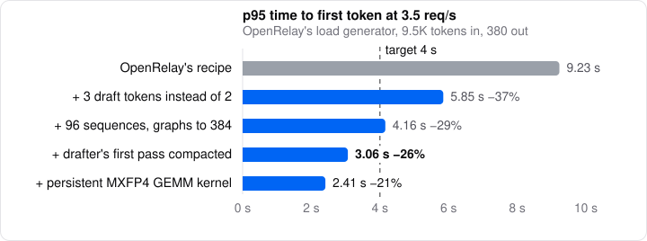
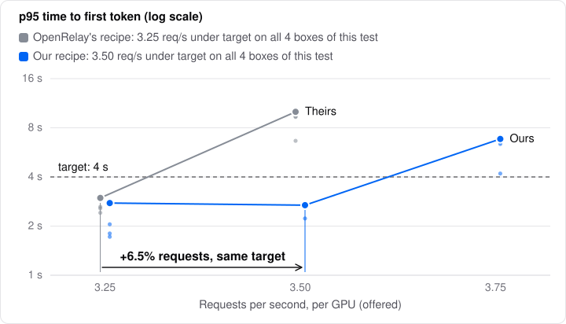

# Serving open models cheaper than OpenRelay

We took the models [OpenRelay](https://openrelay.inc) sells, ran them ourselves on rented spot GPUs, and measured them
the way OpenRelay measures its own service: the same request mix, the same latency target, the same load generator.
Then we asked two questions. On identical hardware, can we serve more requests than their published recipe? And how
does our cost per request compare with their price list?

<picture>
  <source media="(prefers-color-scheme: dark)" srcset="docs/img/ablation-dark.svg">
  
</picture>

*Each row adds one of our changes to the row above, starting from OpenRelay's published recipe, measured at 3.5 req/s with their load generator. The first four rows are screens, one box each (seed 8), on different boxes; the last row is the slowest of four boxes in the paired confirm. The drafter fix is the change that crosses the 4 s target.*

## Results at a glance

| model and question | result | more |
|---|---|---|
| Gemma 4 31B — our recipe vs OpenRelay's, same GPUs | Our final recipe held 3.5 req/s on all 6 boxes we tested; OpenRelay's held 3.5 on 0 of 10 and 3.25 on 7 of 10 (counts per box). On real text in the latest test: ours 3 req/s, theirs 2.75 req/s | [same-hardware comparison](docs/WRITEUP.md#h1-our-deployment-vs-theirs-on-the-same-hardware-the-comparison-that-matters) |
| Gemma 4 31B — our cost vs their price list | 0.43× of their standard price, 0.86× of their batch price; 0.58× on real text | [cost vs price](docs/WRITEUP.md#h2-our-cost-vs-their-api-price-a-different-question) |
| Inkling 2 Mini — vs the cheapest provider | 0.66× on a B300 and 0.83× on an RTX PRO 6000 (real text) | [Inkling notes](recipes/inkling/README.md) |
| GLM-5.3-Flash — vs OpenRelay's GLM price | 1.81× on real text: we lose | [GLM notes](recipes/glm/README.md) |

A ratio below 1× means we are cheaper. Every result holds on two independent load seeds at every load level up to
the one quoted, with 95% of requests getting their first token within 4 seconds.

<picture>
  <source media="(prefers-color-scheme: dark)" srcset="docs/img/knee-dark.svg">
  
</picture>

*In the first paired test, the same four MI355X GPUs each served OpenRelay's recipe and ours back to back with OpenRelay's own load generator (300 s per rate, two seeds, log scale). Lines follow the slowest box at each rate, dots are single boxes. Ours holds the 4 s target at 3.50 req/s on all four boxes, theirs at 3.25: 6.5% more completed requests per GPU-hour. At 3.50 req/s the slowest box answers in 2.69 s with ours and 10.0 s with theirs. In a later test on four other boxes this recipe missed 3.50 req/s on one of them; the final recipe, with the persistent GEMM kernel, held it on all four.*

<picture>
  <source media="(prefers-color-scheme: dark)" srcset="docs/img/price-dark.svg">
  
</picture>

*Our cost per request at each model's claim rate, on OpenRelay's random-token benchmark and on real text, against the price we compare with: OpenRelay's Sync and Batch tiers for Gemma, the cheapest OpenRouter provider for Inkling 2 Mini, and OpenRelay's own price for GLM-5.3-Flash. Gemma comes in at 0.43× their Sync price (0.86× Batch) and Inkling at 0.66× at best; GLM costs 1.81× or more, so there we lose.*

## What we found

- **A wasted step in vLLM's Gemma 4 speculative decoder.** Its draft model re-reads every prompt chunk and throws
  the work away. Skipping it is what took our recipe reliably under the latency target at 3.5 req/s, and it speeds up
  their recipe too. The fix is upstream for review as [vLLM pull request #69275](https://github.com/vllm-project/vllm/pull/69275).
  [The details](docs/WRITEUP.md#the-find-vllms-gemma-4-mtp-drafter-runs-every-prefill-chunk-through-its-first-pass-and-throws-it-away)
- **A faster matrix kernel, and a power wall.** A newer AMD kernel adds about 4% prompt throughput; past that, the
  GPU is limited by power rather than by its datasheet peak. [The details](docs/WRITEUP.md#the-second-find-aiters-persistent-mxfp4-gemm-and-a-power-limited-ceiling-journal-steps-400-404-139)
- **Random-token benchmarks undersell speculative decoding.** On real text the draft models are right far more
  often, so a benchmark of random tokens makes them look worse than they are (GLM and Inkling both show it).

## How we measured

- OpenRelay's own protocol: long prompts (about 9,500 tokens in, 380 out), random arrival times, and a target of
  95% of requests starting their answer within 4 seconds. [Method](docs/WRITEUP.md#1-the-question)
- Two kinds of load: OpenRelay's random-token benchmark, and real text. A price claim has to hold on real text.
- Each claim, and the rule that decides it, is listed in [the claims table](results/CLAIMS.md); every experiment
  along the way is in [the journal](docs/JOURNAL.md).

To run a recipe yourself, start from the [MI355X Gemma recipe](recipes/mi355x/README.md), the
[GLM recipe](recipes/glm/README.md) or the [Inkling recipe](recipes/inkling/README.md).

**Caveats.** Spot GPUs differ from box to box (about 6% in clock speed), so results are stated per recipe across
several boxes, never from one lucky box. [Scope and open questions](docs/WRITEUP.md#h4-scope-and-open-items)

**Licences.** Code: [MIT](LICENSE). Prompt text: Wikipedia (CC BY-SA 4.0), UltraChat 200k (MIT); evals: GSM8K (MIT),
MMLU-Pro (MIT). The copy of OpenRelay's recipe in `research/raw/openrelay_recipe/` keeps its Apache-2.0 licence.
