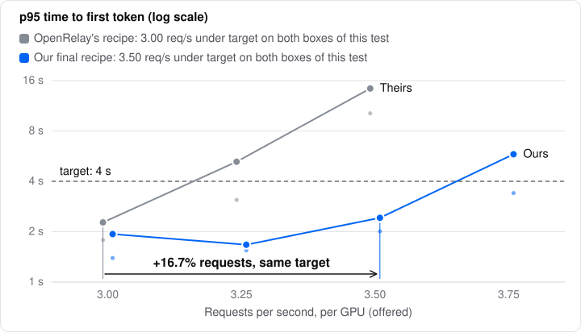
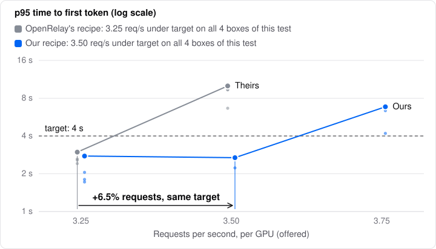
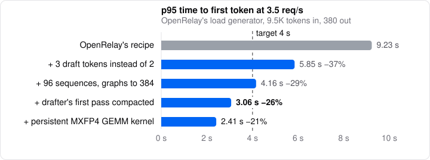
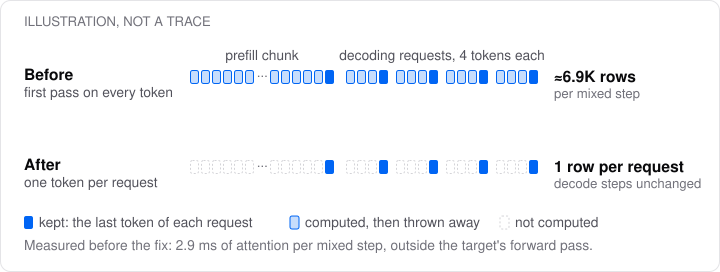
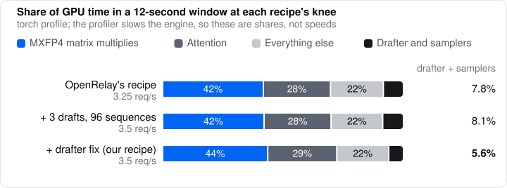

# Self-hosting open models against OpenRelay: write-up

Status: 2026-11-22. Numbers come from `results/claims.json` (the README's table is generated from it); each section
names the runs behind its numbers. Two runs are still landing: confirm C2b and B300 e5 seed 8.

**Summary**
- **Same hardware (H1):** on the same MI355X boxes, our final recipe held OpenRelay's latency target at 3.5 req/s on every
  box we tested (6 of 6); their recipe never held 3.5 (0 of 10 boxes) and held 3.25 on 7 of 10. On real text, ours holds
  3.0 req/s and theirs 2.75 in the latest test.
- **Price (H2):** our cost is 0.43× their Sync price and 0.86× Batch on their client (4 vCPU host), 0.58× Sync on real text.
- **With prompt caching (column C):** both recipes roughly double their capacity; ours stays ~7-11% ahead.
- **Inkling 2 Mini:** beats the cheapest market price on real text (B300 0.66×, PRO 6000 0.83×). On OpenRelay's
  random-token client the B300 only ties: its speculative decoder accepts half as many tokens on random text.
- **GLM-5.3-Flash:** we lose (1.89× / 1.81× OpenRelay's GLM price); prefill is the wall.
- **Findings:** vLLM's Gemma 4 MTP drafter wastes its first pass on every prefill chunk; aiter's persistent MXFP4 GEMM
  adds ~4% prefill, and the FP4 ceiling is power-limited.

**Contents:** [1. The question](#1-the-question) · [Headline](#headline-draft) ·
[H1](#h1-our-deployment-vs-theirs-on-the-same-hardware-the-comparison-that-matters) ·
[H1 with prompt caching](#h1-with-prompt-caching-column-c-supplementary-not-openrelays-method) ·
[the drafter find](#the-find-vllms-gemma-4-mtp-drafter-runs-every-prefill-chunk-through-its-first-pass-and-throws-it-away) ·
[the GEMM find](#the-second-find-aiters-persistent-mxfp4-gemm-and-a-power-limited-ceiling-journal-steps-400-404-139) ·
[H2](#h2-our-cost-vs-their-api-price-a-different-question) · [H3](#h3-host-sizing-a-daytona-lever-not-a-recipe-win) ·
[H4](#h4-scope-and-open-items) · [2. Their recipe reproduced](#2-their-recipe-reproduced-on-daytona-cost-vs-their-api-price-claim-grade-journal-step-16) ·
[4. What we learned](#4-what-we-learned-the-journey-docsjournalmd-has-every-step) ·
[5a. Quality](#5a-quality-vs-the-bf16-original-resultsquality_tablemd-journal-step-19) · [5b. Other models](#5b-future-work) ·
[6. Spend and reproducibility](#6-spot-evictions-spend-reproducibility)

Tables: `results/CLAIMS.md` (claims), `results/PROTOCOL_TABLE.md`, `results/COLUMN_C.md`, `results/QUALITY_TABLE.md`, and
`docs/JOURNAL.md` (every step), all rebuilt by `python3 -I analysis/report.py`.

## 1. The question

Can a self-hosted Gemma 4 31B-it on rented, preemptible GPUs serve requests more cheaply than OpenRelay sells them,
under OpenRelay's own benchmark protocol?

- **Bar:** OpenRelay's published Gemma 4 31B price ($0.07 / 1M input, $0.007 / 1M cached, $0.30 / 1M output) makes a
  9.5K-in / 380-out request **$0.000779** (`research/openrelay_prices_*.json`).
  - Their Batch tier is half that ($0.000390).
  - OpenRouter's cheapest provider is a second column.
- **Our cost per request:** sandbox $/h divided by the **achieved** request rate of the **worst seed** at the highest
  offered rate where **every** seed meets the SLO.
  - The sandbox $/h is GPU spot + vCPU + RAM + disk at Daytona's published rates (conservative).
  - Daytona's metered bill is shown beside it: GPU prices match the published page exactly, but the host part bills
    ~40% below published, so the metered $/request is 10–15% lower (`results/metered_usd.json`).
- **Protocol:** OpenRelay's, copied from their bench scripts (`research/raw/openrelay_recipe/`):
  - open-loop Poisson arrivals; 9.5K / 380 tokens (uniform ±80%); 300 s per rate; seeds 7 and 8, the worse one kept;
  - SLO: p95 TTFT < 4 s with < 1% errors;
  - prefill probe: 16 concurrent × 10K-token prompts, run twice, the second counts;
  - quality gate: GSM8K with their prompt and `####` scoring, ≥ 96.5%.
- **Two load columns. The price claim must hold on column B (real text); column A is always shown beside it, and any
  column-A shortfall is stated in the same line** (round-2 decision). A claim rate is the top of the
  monotonic prefix: every cell of every tested rung up to it passes; a higher pass above a failing rung is shown beside
  it, never claimed (`analysis/screen_report.py` `monotonic_claim`).
  - **A: OpenRelay's client** (`vllm bench serve`, random-token prompts). It is comparable with their number, but
    their own script admits random tokens give 97–98% MTP acceptance per position, "far above real text".
  - **B: our real-text client** (`bench/traffic.py`). It sends chat requests built from public Wikipedia text.
    Prompts are cut to an exact token count with the served model's tokenizer. Outputs are forced to the sampled length.
    Arrivals are an exact count of Poisson arrivals (rate × cell length), as `vllm bench serve` does.
  - Every column-B cell is scored over a full 300 s window (`bench/protocol.py` `score_cell`).
  - A request with no first token by the window end counts as infinitely late for pass/fail; its lower bound is reported.
  - New cells run 360 s with a 60 s warm-up. Older 300 s cells were re-scored over 0–300 s, warm-up included.
  - They had been judged on a 240 s window that dropped end-of-run requests (independent review, `research/review_recipe_C1_grok_20261122.md`, caveat 1).
- **Claim-grade** (enforced by `analysis/screen_report.py` → `results/CLAIMS.md`) requires:
  - ≥ 2 seeds and a **scored** window of 300 s per cell;
  - the engine's own Prometheus prompt-token counter within 1% of what the client counted, over the whole cell. vLLM counts
    at prefill and SGLang at completion, so window deltas don't compare across engines (`bench/counter_probe.py`);
  - for column B, tokenizer-exact, stratified prompts with a realized mean within 9.5K ±2%.
  - Screen rungs (120 s, one seed) only screen; they never rank boxes or support a claim.

## Headline (draft)

### H1. Our deployment vs theirs, on the same hardware (the comparison that matters)

> **Our final recipe holds OpenRelay's SLO at 3.50 req/s with their own client on every box of the three-way confirm (4 of 4,
> worst p95 TTFT 2.41 s). It is our version of their recipe plus aiter's persistent MXFP4 GEMM, `MX_PS_FP4`. On the same
> four boxes, their recipe fails 3.25 req/s on both seed-8 boxes. On the 4 vCPU host that is $0.000338 per request:
> 0.435× their Sync price and 0.868× Batch (metered 0.408× / 0.816×).**

**Three-way confirm C2** (journal step 139; `mxC2_s7_r1`, `mxC2_s7_r2`, `mxC2_s8_r1`, `mxC2_s8_r2`, 4 vCPU / 24 GiB host).
Each box served theirs, ours-today and ours + `MX_PS_FP4` (the "stack") back to back. They used the same image digest,
client and seeds. Claim groups: `mx_stack_C2`, `mx_recipe_C2`, `or_recipe_paired_C2`.

| C2, their client (column A) | stack (ours + `MX_PS_FP4`) | ours-today | theirs |
|---|---|---|---|
| claim: highest rate every box passes | **3.50 req/s** (claim-grade) | 3.25 req/s (3.5 missed on `mxC2_s8_r2`, p95 4.17 s) | **none**: fails 3.25 on `mxC2_s8_r1` (4.32 s) and `mxC2_s8_r2` (5.39 s); no 3.0 rung was run |
| p95 TTFT at 3.50 req/s, per box | 2.17 / 1.79 / 2.20 / 2.41 s (4/4 pass) | 2.99 / 1.99 / 3.44 / 4.17 s (3/4) | 11.4 / 5.2 / 13.2 / 14.5 s (0/4) |
| prefill, OpenRelay's 16×10K probe | 44,776–46,411 tok/s | 42,931–45,159 tok/s | 41,469–43,595 tok/s |
| $/request at the claim (worst box achieved) | $0.000338 (0.435× Sync) | $0.000363 (0.466×) | — |

- **Real text (column B) has no claim-grade rate in C2 for any of the three:**
  - the stack's ladder was 3.5 / 3.75 only (no lower rung); it fails 3.5 on `mxC2_s7_r1` (12.2 s) and passes it on
    `mxC2_s8_r1` (3.54 s);
  - theirs ran 3.25 only (no lower rung) and fails it on both text boxes (13.7 / 8.4 s);
  - ours-today fails 3.25 on `mxC2_s7_r1` (7.26 s) and passes it on `mxC2_s8_r1` (3.03 s).

  The fill-in confirm C2b supplies those rates.

**Fill-in confirm C2b** (journal step 140; `mxC2b_s7`, `mxC2b_s8`, same three servers per box, ladders from 3.0 req/s,
2.75 for theirs on real text). Claims from `results/claims.json`, every rung up to the rate passing on both seeds:

| C2b | stack (ours + `MX_PS_FP4`) | ours-today | theirs |
|---|---|---|---|
| their client (column A) | **3.5 req/s (0.430×)** | 3.25 req/s (0.467×) | 3 req/s (0.502×) |
| real text (column B) | **3 req/s (0.505×)** | 3 req/s (0.512×) | 2.75 req/s (0.587×) |

The ratios are $/request vs OpenRelay's Sync price, on the 4 vCPU host.

<!-- fig:knee-final -->
<picture>
  <source media="(prefers-color-scheme: dark)" srcset="img/knee-final-dark.svg">
  
</picture>

*In the fill-in paired test, the same two MI355X GPUs each served OpenRelay's recipe and our final recipe back to back with OpenRelay's own load generator (300 s per rate, two seeds, log scale). Lines follow the slowest box at each rate, dots are single boxes. Ours holds the 4 s target at 3.50 req/s on both boxes, theirs at 3.00: 16.7% more completed requests per GPU-hour. At 3.50 req/s the slowest box answers in 2.42 s with ours and 14.4 s with theirs. Across every same-box test on their client, the final recipe held 3.50 req/s on 6 of 6 boxes; theirs held 3.00 on 2 of 2, 3.25 on 7 of 10 and 3.50 on 0 of 10.*
<!-- /fig -->

**Per box, across every same-box paired test (C1 + C2 + C2b).** These are counts, not claims (the claims are per test
group, above). Generated by `analysis/box_counts.py` into `results/BOX_COUNTS.md`:

**OpenRelay's client (random tokens)**

| recipe | boxes | 3 req/s | 3.25 req/s | 3.5 req/s | 3.75 req/s |
|---|---|---|---|---|---|
| final recipe (ours + MX_PS_FP4) | 6 | 2 of 2 | 6 of 6 | 6 of 6 | 2 of 6 |
| ours-today | 10 | 2 of 2 | 10 of 10 | 8 of 10 | 1 of 8 |
| theirs (OpenRelay's recipe) | 10 | 2 of 2 | 7 of 10 | 0 of 10 | not run |

**real text**

| recipe | boxes | 3 req/s | 3.25 req/s | 3.5 req/s | 3.75 req/s |
|---|---|---|---|---|---|
| final recipe (ours + MX_PS_FP4) | 4 | 2 of 2 | 1 of 2 | 1 of 4 | 0 of 1 |
| ours-today | 7 | 2 of 2 | 5 of 7 | 1 of 7 | not run |
| theirs (OpenRelay's recipe) | 7 | 1 of 2 | 1 of 7 | 0 of 3 | not run |

TPOT p50 at 3.50 req/s on their client (C1 + C2 boxes): stack 22.7–30.8 ms, ours-today 25.7–43.6 ms, theirs 42.4–47.2 ms.

<!-- fig:knee -->
<picture>
  <source media="(prefers-color-scheme: dark)" srcset="img/knee-dark.svg">
  
</picture>

*In the first paired test, the same four MI355X GPUs each served OpenRelay's recipe and ours back to back with OpenRelay's own load generator (300 s per rate, two seeds, log scale). Lines follow the slowest box at each rate, dots are single boxes. Ours holds the 4 s target at 3.50 req/s on all four boxes, theirs at 3.25: 6.5% more completed requests per GPU-hour. At 3.50 req/s the slowest box answers in 2.69 s with ours and 10.0 s with theirs. In a later test on four other boxes this recipe missed 3.50 req/s on one of them; the final recipe, with the persistent GEMM kernel, held it on all four.*
<!-- /fig -->

**The first paired confirm, C1** (8 vCPU host): ours holds 3.50 req/s on their client where theirs holds 3.25. That is
6.5% more completed requests per GPU-hour on identical hardware. On real text ours passes 3.25 req/s and theirs fails it.
The design (`mxC1_s7_r1`, `mxC1_s7_r2`, `mxC1_s8_r1`, `mxC1_s8_r2`; claim groups `mx_recipe_C1` vs
`or_recipe_paired_C1`):
- Each box ran their recipe and ours back to back, alternating which went first (r1: ours first on seed 7, theirs first
  on seed 8; r2: the reverse).
- Both used the same image digest, the same client and seeds, and max-model-len 32768.
- The pairing is free of the ~6% box-to-box clock spread.

| same boxes, their client (column A) | ours | theirs |
|---|---|---|
| highest rate every box passes | **3.50 req/s** | 3.25 req/s |
| worst-box achieved at that rate | 3.405 req/s | 3.198 req/s (+6.5% for ours) |
| p95 TTFT at 3.50 req/s (SLO < 4 s) | **2.23–2.69 s** (4/4 pass) | 6.66–10.01 s (4/4 fail) |
| TPOT p50 at 3.25 req/s | 20.3–22.3 ms | 28.1–37.8 ms |
| prefill, OpenRelay's 16×10K probe | 43,635–44,437 tok/s | 42,158–42,922 tok/s (ours +2.9% to +3.7% per box) |
| GSM8K test[:250], same box (`q2_mi355x_recipes`) | 247/250 | 247/250 |
| real text (column B) at 3.25 req/s | **passes**, worst full-window p95 3.34 s | fails: 4.60 / 5.17 / 3.85 s |

How to read it:
- The ladder steps by 0.25 req/s, so the true knee of each recipe lies somewhere between steps. The "+6.5%" is a
  step-quantised throughput difference, not a measured knee.
- The sharper evidence is the latency gap at the same rate. At 3.50 req/s ours has p95 TTFT 2.2–2.7 s and theirs
  6.7–10.0 s; at 3.25 ours decodes at 20–22 ms per token against their 28–38 ms.
<!-- fig:ablation -->
<picture>
  <source media="(prefers-color-scheme: dark)" srcset="img/ablation-dark.svg">
  
</picture>

*Each row adds one of our changes to the row above, starting from OpenRelay's published recipe, measured at 3.5 req/s with their load generator. The first four rows are screens, one box each (seed 8), on different boxes; the last row is the slowest of four boxes in the paired confirm. The drafter fix is the change that crosses the 4 s target.*
<!-- /fig -->

- **What "ours" is:** their image, by the same digest, with four changes (`recipes/mi355x/`):
  - a drafter-compaction patch: the MTP drafter's first pass runs one token per request (`box/patch_draft_compact.py`,
    `MX_DRAFT_COMPACT=1`);
  - MTP k=3 instead of 2;
  - `--max-num-seqs` 96 instead of 64;
  - CUDA graphs captured up to 384 instead of 256;
  - in the final recipe ("stack", C2), also aiter's persistent MXFP4 GEMM for large M (`MX_PS_FP4=1`; see "The second find").
- **The drafter patch does not change outputs.** Patched vs unpatched, temperature 0: 60/60 token-identical at concurrency 1,
  on both repeats (`results/mxID_identity/20261122T075235Z`, `idprobe_{on,off}_c1_{a,b}.json`). Concurrency 16 cannot
  separate a patch effect: batch composition alone changes 41 of 60 outputs. The next section has the controls.

**Finer knee search (supplementary, not a claim; journal step 133).** Same design, on four more boxes (`mxF_s7_r1`,
`mxF_s7_r2`, `mxF_s8_r1`, `mxF_s8_r2`), with rungs between the 0.25 steps. Column A:

| rate | ours: boxes passing | theirs: boxes passing |
|---|---|---|
| 3.3 req/s | (not run) | 2 of 4 (p95 3.10 / 3.40 s pass; 4.42 / 6.02 s fail) |
| 3.4 req/s | (not run) | 0 of 4 |
| 3.6 req/s | 3 of 4 (p95 2.84 / 3.53 / 3.17 s; 5.31 s fail) | (not run) |
| 3.7 req/s | 1 of 4 | (not run) |

- **Box clocks.** The boxes' median GPU clock under load (from `gpumon_norm.csv`) was 2,034, 1,961, 2,029 and 1,973 MHz.
  - Ours missed 3.6 only on the 1,973 MHz box.
  - Theirs passed 3.3 only on the two ~2,030 MHz boxes.
- **Reading.** Each knee sits at roughly 3.6 (ours) and 3.3 (theirs) req/s, with the box clock deciding the boundary cells.
  The claim stays 3.50 vs 3.25, every cell passing.

### H1 with prompt caching: column C (supplementary; NOT OpenRelay's method)

Maks asked for it ("if we did not do that before, then try it and see what happens"); nothing before this measured
prompt-cache reuse. Both recipes were run verbatim from C1, prefix caching on in both, ours vs theirs back to back on each
box (seed 7 ours first, seed 8 theirs first). Each box contributes 300 s scored cells. Every number comes from
`results/COLUMN_C.md` / `results/column_c.json` (`analysis/column_c.py`); configs from `configs/mk_column_c.py`.

| claim (every seed passes every rung up to it), `results/claims.json` | ours | theirs |
|---|---|---|
| C1 fit: shared prefixes, ~76% of input tokens cached | **7.5 req/s** (fails 8.0) | 6.75 req/s (fails 7.0) |
| C2 agent sessions, ~65% cached | **7.5 req/s** (fails 8.0) | 7.0 req/s (fails 7.5) |
| C1 evict: prefixes 3× the KV pool, ~14-17% cached | 3.5 req/s (fails 4.5) | 3.5 req/s (fails 4.5) |
| $/request at the claim vs OpenRelay's price for THIS traffic (cached input at $0.007/1M) | C1 0.525×, C2 0.467× | C1 0.576×, C2 0.494× |

- **Caching roughly doubles both recipes' capacity** (uncached knees ~3.3-3.6 req/s, H1 above), and both read the same
  cached share. The two cache reads, usage `cached_tokens` and vLLM's prefix-cache counters, agree within 0.002 in every
  cell.
- **The gap does not widen much.** On boxes where both recipes ran a common rung, ours passes a rung theirs fails on 3 of 4
  (C1) and 2 of 4 (C2), and theirs never passes a rung ours fails. In absolute terms ours is ~0.5-0.75 req/s ahead (C1 7.5 vs 6.75, C2 7.5 vs 7.0),
  against 0.25 uncached; in relative terms that is ~7-11%, about the uncached ~7%.
- **The C1 gap is narrow on seed 7:** theirs passes 7.5 on `cc_c1_s7` (p95 3.53 s) and 7.0 on `cc_x2_s7`. The claim
  difference comes from seed 8, where theirs fails 7.0 and 7.5.
- **Under eviction, caching stops helping both equally at the SLO.** At 3.5 req/s the hit share is the same on each box
  (13.8 vs 14.0%, 16.3 vs 16.7%), and ours has the lower p95 (1.33 vs 2.28 s, 1.41 vs 1.74 s).
- **Beyond the SLO knee,** our extra running slots (96 vs 64) cost hit rate. At 4.5 req/s under eviction ours caches
  11.9 / 14.2% against theirs 13.4 / 15.0%. On C2 at 8.5 req/s (`cc_x_s7`, a failing cell) our cached share fell from 0.65
  to 0.45 as the KV pool filled with running requests.

**C1 fit: 38 shared 7.6K-token prefixes (0.30× the KV pool).** Each row is one box; each cell is ours / theirs at that rate (p95 TTFT; SLO < 4 s).

| box (seed) | 4 req/s | 5 req/s | 6 req/s | 6.75 req/s | 7 req/s | 7.5 req/s | 8 req/s | 8.5 req/s | 9 req/s |
|---|---|---|---|---|---|---|---|---|---|
| `cc_c1_s7` (s7) | pass 0.24 s / pass 0.25 s | pass 0.27 s / pass 0.28 s | pass 0.33 s / pass 0.34 s | — | — | pass 0.46 s / pass 3.53 s | — | — | — |
| `cc_x2_s7` (s7) | — | — | — | — | pass 0.39 s / pass 0.88 s | — | pass 2.01 s / **fail** 15.41 s | **fail** 10.83 s / — | — |
| `cc_x_s7` (s7) | — | — | — | — / pass 0.62 s | — | — | — | — | **fail** ∞ s / — |
| `cc_c1_s8` (s8) | pass 0.27 s / pass 0.27 s | pass 0.29 s / pass 0.28 s | pass 0.34 s / pass 0.36 s | — | — | pass 0.64 s / **fail** 7.54 s | — | — | — |
| `cc_x2_s8` (s8) | — | — | — | — | pass 0.39 s / **fail** 4.12 s | — | **fail** 4.25 s / **fail** 14.24 s | **fail** 10.69 s / — | — |
| `cc_x_s8` (s8) | — | — | — | — / pass 3.70 s | — | — | — | — | **fail** ∞ s / — |

Cached share in passing cells (usage / server counter): ours 0.758-0.768 / 0.758-0.768; theirs 0.758-0.768 / 0.759-0.769.

**C2 agent sessions (4 turns, real replies re-sent).** Each row is one box; each cell is ours / theirs at that rate (p95 TTFT; SLO < 4 s).

| box (seed) | 4 req/s | 5 req/s | 6 req/s | 6.75 req/s | 7 req/s | 7.5 req/s | 8 req/s | 8.5 req/s |
|---|---|---|---|---|---|---|---|---|
| `cc_c2_s7` (s7) | pass 0.36 s / pass 0.36 s | pass 0.43 s / pass 0.41 s | pass 0.51 s / pass 0.51 s | — | — | pass 2.82 s / **fail** 14.68 s | — | — |
| `cc_x2_s7` (s7) | — | — | — | — | pass 0.62 s / pass 3.79 s | — | **fail** ∞ s / **fail** ∞ s | — |
| `cc_x_s7` (s7) | — | — | — | — / pass 0.98 s | — | — | — | **fail** ∞ s / — |
| `cc_c2_s8` (s8) | pass 0.34 s / pass 0.34 s | pass 0.43 s / pass 0.41 s | pass 0.53 s / pass 0.56 s | — | — | pass 0.90 s / **fail** 12.22 s | — | — |
| `cc_x2_s8` (s8) | — | — | — | — | pass 0.68 s / pass 3.12 s | — | **fail** 9.08 s / **fail** ∞ s | — |
| `cc_x_s8` (s8) | — | — | — | — / pass 1.89 s | — | — | — | **fail** ∞ s / — |

Cached share in passing cells (usage / server counter): ours 0.648-0.659 / 0.650-0.660; theirs 0.651-0.658 / 0.651-0.658.

**C1 evict: 385 prefixes (3.0× the KV pool).** Each row is one box; each cell is ours / theirs at that rate (p95 TTFT; SLO < 4 s).

| box (seed) | 3.5 req/s | 4.5 req/s |
|---|---|---|
| `cc_c1_s7` (s7) | pass 1.33 s / pass 2.28 s | **fail** ∞ s / **fail** ∞ s |
| `cc_c1_s8` (s8) | pass 1.41 s / pass 1.74 s | **fail** ∞ s / **fail** ∞ s |

Cached share in passing cells (usage / server counter): ours 0.138-0.163 / 0.139-0.162; theirs 0.140-0.167 / 0.141-0.165.

### The find: vLLM's Gemma 4 MTP drafter runs every prefill chunk through its first pass and throws it away

This is the single change that moves our recipe from failing 3.50 req/s to passing it, and it is not specific to MI355X
tuning. Sources: `recipes/mi355x/notes/profile_knee_or_recipe.md` and `recipes/mi355x/notes/upstream_draft_compaction.md`;
journal steps 110, 118, 119, 120.

<!-- fig:drafter-fix -->
<picture>
  <source media="(prefers-color-scheme: dark)" srcset="img/drafter-fix-dark.svg">
  
</picture>

*Illustration, not a trace. vLLM runs the Gemma 4 MTP drafter's first pass over every token the target scheduled, so a step carrying a prefill chunk sends about 6.9K rows through it at the knee, and only the last row of each request is used. Gemma 4's drafter reads the target's KV cache and writes none, so the fix runs that pass on one token per request; the outputs stay token-identical.*
<!-- /fig -->

<!-- fig:gpu-time -->
<picture>
  <source media="(prefers-color-scheme: dark)" srcset="img/gpu-time-dark.svg">
  
</picture>

*Where the GPU's time goes in a 12-second window at each recipe's knee, from a torch profile (the profiler slows the engine, so these are shares, not speeds). The drafter and samplers run outside the target model's forward pass; skipping the drafter's wasted first pass cut their share from 8.1% to 5.6% at the same load, and the matrix multiplies (the MXFP4 GEMM kernels themselves), where a GPU should spend its time, rose to 44%.*
<!-- /fig -->

- **What it is.**
  - In vLLM 0.30, `AutoRegressiveSpeculator.propose` (`vllm/v1/worker/gpu/spec_decode/autoregressive/speculator.py`) runs
    draft position 0 over every token the target scheduled in the step. It reuses the target's attention metadata, then
    keeps only `last_token_indices`, one row per request.
  - EAGLE-style drafters write their own KV, so they need every row. Gemma 4's MTP head (`Gemma4Speculator`) is Q-only: it
    reads the target's KV through cross-model KV sharing, writes none, and `advance_draft_positions` is False.
  - So in every step that carries a prefill chunk (6-8K tokens at the knee), the whole chunk goes through the drafter's 4
    layers, including a full-attention head_dim-512 layer. All but one row per request is then discarded.
- **How it was found.** We used OpenRelay's own method: profile at the knee and chase the biggest slice. We added one tool,
  `recipes/mi355x/box/outside.py`, which attributes kernels that fall outside the target model's step windows. Profile:
  OpenRelay's recipe with MTP k=3 and 96 sequences, at 3.5 req/s
  (`results/mx7_prof_mtp3_seqs96/20261122T054335Z/prof_summary.txt`).
  - 1,000 ms of 12,313 ms kernel time (**8.1%, 7.46 ms per step**) runs outside the target forward: drafter passes, drafter
    BF16 GEMMs and samplers.
  - Inside that slice there is one prefill-shaped head_dim-512 attention call per mixed step: 174.9 ms over 60 calls,
    **~2.9 ms each**. That call is the drafter's first pass over the whole chunk.
  - Precisely: the 8.1% is the drafter-and-sampler share, not all of it waste. The discarded attention measured directly is
    174.9 ms (1.4% of kernel time). The drafter's BF16 MLP work on the discarded rows adds to that, but the profile does
    not split it out.
  - The pass sits on the critical path of every prefill step. Near saturation, queueing turns a small step-time saving into
    a large TTFT change (our reading, consistent with the effects below).
- **The fix.** `recipes/mi355x/box/patch_draft_compact.py`, env-gated by `MX_DRAFT_COMPACT=1`.
  - On steps that contain a prefill, the first pass runs on one token per request, using the decode passes' own position
    and seq_len rule.
  - All-decode steps keep the full CUDA-graph path unchanged.
  - An upstream version would key on the speculator instead of an env var (e.g. a `first_pass_needs_all_tokens` property,
    False for Q-only KV-sharing heads).
- **Identity.** Probe: temperature 0, ignore_eos, 256 tokens; 50 short GSM8K prompts plus 10 random 10K-token prompts.
  Source: `results/mxID_identity/20261122T075235Z`, `recipes/mi355x/box/identity_probe.py`; counts recomputed from the
  saved token ids.
  - **Patched vs unpatched at concurrency 1: 60/60 token-identical, on both runs.**
  - Control, the same unpatched server run twice: 50/60. The 10 that differ are exactly the long prompts, whose second run
    reuses FP8 prefix-cache KV.
  - Control, the same unpatched server at concurrency 1 vs 16: 19/60. Patched vs unpatched at concurrency 16 (23/60) is
    inside that noise.
  - This is the expected result: at temperature 0 the target's greedy verification fixes the output whatever the drafter
    proposes.
- **Effect alone on THEIR recipe** (step 120, `mx11_or_dc`, seed 8). Compared with their recipe's seed-8 control
  (`s2_mi355x_or_recipe_seed8/20261122T043705Z`):
  - prefill probe 42,758 → 44,463 tok/s (+4.0%; the probe's 1-token requests paid the wasted pass too);
  - p95 TTFT at 3.25 req/s 2.55 → 1.99 s;
  - p95 TTFT at 3.50 **9.23 → 5.58 s**, still a fail.

  The ablation and the control ran on different boxes, one seed each: indicative, not claim-grade.
- **Effect in OUR recipe** (step 119 vs its parent step 110, 3.50 req/s, seed 8):
  - p95 TTFT **4.16 → 3.06 s**, a fail turned into a pass;
  - TPOT p50 43.3 → 36.7 ms;
  - acceptance 3.62 → 3.60 tokens per verify step;
  - seed 7 passes at 2.30 s.

  Three more unpatched replicates of step 110 on other boxes failed 3.50 at 4.53, 4.62 and 5.20 s (step 118), so the gain
  is not one lucky box.
- **Who it helps.** Any Gemma 4 MTP deployment on vLLM, NVIDIA included. The waste is still on vLLM main, and the fix
  helps there too, measured on one spot H100 with the official nightly of vLLM main. In an ABBA order, unpatched = the
  installed package, and patched = only the drafter's speculator file replaced. OpenRelay's client, 9.5K / 380 tokens,
  seeds 7 and 8 (`results/up1_h100_draft_compact/20261122T163243Z`, `ab_table.json`):

  | rate, seed | p95 TTFT unpatched → patched | TPOT p50 unpatched → patched |
  |---|---|---|
  | 0.6 req/s, s7 | 3.45 → 3.33 s (-3%) | 15.3 → 15.1 ms (-1%) |
  | 0.6 req/s, s8 | 3.24 → 3.07 s (-5%) | 14.7 → 14.1 ms (-4%) |
  | 0.75 req/s, s7 | 3.89 → 3.76 s (-3%) | 23.2 → 22.3 ms (-4%) |
  | 0.75 req/s, s8 | 4.62 → 4.29 s (-7%) | 23.2 → 21.5 ms (-7%) |
  | 0.9 req/s, s7 | 4.91 → 4.73 s (-4%) | 41.4 → 39.8 ms (-4%) |
  | 0.9 req/s, s8 | 7.01 → 5.91 s (-16%) | 45.9 → 41.3 ms (-10%) |

  - p95 TTFT is lower in all 6 cells (-3% to -16%) and TPOT p50 is 1-10% lower.
  - OpenRelay's prefill probe goes 12,368 → 12,681 tok/s (+2.5%).
  - Patched vs unpatched output is 60/60 token-identical at concurrency 1, temperature 0.
  - The PR adds a test that the first draft pass runs on last tokens only. It fails on unpatched main, as it should, and
    passes patched:
    - unit tests: base 1 failed, patched 36 of 36 passed;
    - end-to-end: patched failed once in the first run and passed in the rerun (`results/up2_h100_e2e_tests`);
    - the Gemma 4 end-to-end suite passes patched, 2 of 2.
- **Upstream: open for review as [vLLM pull request #69275](https://github.com/vllm-project/vllm/pull/69275)**, "Run
  draft step 0 of Q-only drafters on last tokens only" (opened 2026-11-22). It splits out item 2 of the earlier
  [vLLM #60689](https://github.com/vllm-project/vllm/pull/60689), which bundled the same change with two others, and
  credits it. The original draft text is in `recipes/mi355x/notes/upstream_draft_compaction.md`.

### The second find: aiter's persistent MXFP4 GEMM, and a power-limited ceiling (journal steps 400-404, 139)

Source: `recipes/mi355x/notes/gemm_headroom.md`; runs `mxG1_asm`, `mxG1_alt`, `mxG1b_ab`, `mxG2_s7`, `mxG2_s8`, then the
three-way confirm C2.
- **The ceiling is set by power, not by the datasheet.** Under sustained FP4 GEMM load with realistic data, the GPU holds
  ~1.6-1.8 GHz at 1,340-1,390 W. The same MFMA stream runs at 2.38 GHz on zeros and 1.72 GHz on random bits. So the
  practical ceiling is ~86% of the dense peak at the clock actually held (~5.8-6.2 PFLOP/s), not ~8.4 PF at 2.0 GHz.
  Earlier "half of peak" framings used the serving-average clock and overstated the headroom.
- **The engine path sits 16-30% below that ceiling at prefill sizes:** 4.3-4.9 PF at M = 8192, 60-72% of clock-adjusted
  peak.
- **The swap:** aiter v0.1.30's persistent 256×256 MXFP4 kernel for M >= 1536-2048 (`MX_PS_FP4=1`, `box/patch_ps_fp4.py`).
  It matches the engine path's output to < 5e-6 on the tested shapes and is 1.07-1.15× faster at M = 8192 on two boxes.
  - Paired in the engine: prefill +4.2% and +3.9% (44,218 → 46,069 and 43,730 → 45,437 tok/s), TPOT p50 10-30% lower at
    3.5-3.75 req/s.
  - That is ~4% at the engine level, as the microbenchmark predicted.
- **What it buys:** the margin that makes 3.50 req/s hold on every C2 box (4 of 4, worst p95 2.41 s), where ours-today
  missed one. It reaches 3.75 on 1 of 4 boxes only, so 3.75 is not a claim.

**Measured and ruled out** (each with a same-box A/B or a profile share under the bar; journal step in brackets):

| lever | result |
|---|---|
| Gemma 4 "glue" (attention prep, sandwich norms, MXFP4 quant) vs aiter fused kernels [405, 406] | best swap ~0.5% of a prefill forward; bar was 1.5% (`notes/glue_headroom.md`) |
| BF16 lm_head and MTP-drafter linears in FP8 [407, 408] | BF16 GEMMs are 1.7% of the knee window, so 2× would save ~0.8%; FP8 lm_head shifts the target's logits (top-1 agrees on 81-93% of rows) (`notes/bf16_gemm_headroom.md`) |
| attention re-tune: split prefill/decode launches [129]; d512 prefill-shaped tile [130] | ~1.5% before the extra launches; the tile crashes the Triton/LLVM compiler at >= 63 decodes in a step |
| sampler [128] | top-k/top-p + resample = 0.46% of the knee window |
| scheduling: `--long-prefill-token-threshold` 6144 / 4096 [134] | no gain, same box (p95 at 3.5: 3.52 → 3.64 / 3.52 s) |
| round 4 on the stack: batched tokens 10240 / 12288, max-num-seqs 80 / 112 [135-138] | no gain or within noise, same box; 10240 also shrinks the KV pool 974K → 813K tokens |
| SGLang 0.5.23 ROCm [125, 126, 127] | cannot load the MXFP4 checkpoint; on FP8 it prefills 41% slower than vLLM on identical weights |

### H2. Our cost vs their API price (a different question)

<!-- fig:price -->
<picture>
  <source media="(prefers-color-scheme: dark)" srcset="img/price-dark.svg">
  
</picture>

*Our cost per request at each model's claim rate, on OpenRelay's random-token benchmark and on real text, against the price we compare with: OpenRelay's Sync and Batch tiers for Gemma, the cheapest OpenRouter provider for Inkling 2 Mini, and OpenRelay's own price for GLM-5.3-Flash. Gemma comes in at 0.43× their Sync price (0.86× Batch) and Inkling at 0.66× at best; GLM costs 1.81× or more, so there we lose.*
<!-- /fig -->

Daytona spot rental against OpenRelay's published per-token price. Their price includes their margin and overheads, so
this answers "is self-hosting on rented spot GPUs cheaper than their API", not "is our deployment better than theirs".

> **Cheapest claim-grade price: our recipe on the small host (4 vCPU / 24 GiB, $4.17/h) serves their client at 3.50 req/s
> on 4 of 4 cells. That is $0.000336 per request: 0.432× their Sync price and 0.863× their Batch price, so it beats Batch.
> At Daytona's metered rate it is $0.000316 (0.405× Sync, 0.811× Batch).** The host size is a Daytona lever their recipe
> would also get (H3).

| claim group (`results/CLAIMS.md`) | column | every seed passes up to | cells | worst-seed achieved | $/request | × OpenRelay Sync | × metered |
|---|---|---|---|---|---|---|---|
| `mx_recipe_c4m24` (ours, small host) | A, their client | 3.50 req/s | 4 | 3.442 | $0.000336 | **0.432×** | 0.405× |
| `mx_stack_C2` (ours + `MX_PS_FP4`, small host) | A, their client | 3.50 req/s | 4 | 3.419 | $0.000338 | **0.435×** | 0.408× |
| `mx_recipe_C1` (ours) | A, their client | 3.50 req/s | 4 | 3.405 | $0.000388 | **0.498×** | 0.446× |
| `mx_recipe_C1` (ours) | B, real text | 3.25 req/s | 3 | 2.917 | $0.000453 | **0.582×** | 0.520× |
| `or_recipe_paired_C1` (theirs, same boxes) | A | 3.25 req/s | 4 | 3.198 | $0.000413 | 0.530× | 0.475× |
| `s2_mi355x_or_recipe` (theirs, reproduction) | B, real text | 3.00 req/s | 2 | 2.803 | $0.000471 | 0.605× | 0.542× |

- **Against their Batch tier ($0.0003895 per 9.5K/380 request):**
  - the small host (`mx_recipe_c4m24`, column A) is 0.863× Batch (0.811× metered): below Batch;
  - the standard host (`mx_recipe_C1`), $0.000388, ties with Batch on their client;
  - real text, $0.000453, beats their Sync price but not Batch.
- **The small host has no real-text claim.** Three of four cells pass 3.25 req/s; `mxH4b_s7` fails it (p95 5.55 s). So the
  real-text price stays `mx_recipe_C1`'s 0.582×.
- Their own recipe reproduced on Daytona spot costs 0.530× (their client) and 0.605× (real text) of their Sync price. That
  saving comes from Daytona's spot price, not from engineering (§2).

### H3. Host sizing: a Daytona lever, not a recipe win

On a 4 vCPU / 24 GiB host ($4.17/h instead of $4.76/h), our recipe holds their client at 3.50 req/s on 4 of 4 cells.
That gives H2's price: 0.432× Sync, 0.405× metered. Source: claim group `mx_recipe_c4m24`; runs `mxH4_s7/20261122T072841Z`,
`mxH4_s8/20261122T072720Z` and the replication `mxH4b_s7/20261122T091523Z`, `mxH4b_s8/20261122T091521Z` (journal step 131).
The replication's per-second CPU sampler shows the 4 vCPUs are not starved.
- **Real text is not claim-grade on the small host.** 3.25 req/s passes on 3 of 4 cells, but `mxH4b_s7` fails at p95 5.55 s.
- **Their recipe would get the same host saving,** so this is never a comparison with their recipe. It answers "what does
  the cheapest Daytona box that still holds the SLO cost".

### H4. Scope and open items

- **Recipe comparisons cover Gemma 4 31B only.** OpenRelay has published exactly one deployment recipe:
  `OpenRelayInc/inference-recipes` contains only `gemma-4-31b-mi355x`. Its latest commit is 6767b4d, 2026-09-29, checked via
  the GitHub API on 2026-11-22 (`research/raw/openrelay_inference_recipes_contents_*.json`; Apache-2.0, LICENSE saved under
  `research/raw/openrelay_recipe/full/`).
  - GLM-5.3-Flash and Inkling 2 Mini can therefore only be compared against a price, not against their deployment.
- **Context length: the ranking holds at 256K.** Their recipe serves 32K context (`--max-model-len 32768`), while their
  API advertises 256K ([openrelay.inc/inference-pricing](https://openrelay.inc/inference-pricing), fetched 2026-11-22). So both recipes were re-run paired with
  `--max-model-len 262144`, otherwise unchanged (`mxK_s7/20261122T091535Z`, `mxK_s8/20261122T091533Z`, journal step 132).
  - **Column A (their client):**
    - ours passes 3.25 req/s on both seeds (p95 1.91 / 2.27 s; claim-grade `mx_recipe_ctx256k`, 0.531× Sync);
    - theirs passes 3.25 on seed 7 (3.57 s) and fails it on seed 8 (5.23 s);
    - at 3.5 ours passes seed 7 (3.16 s) and fails seed 8 (4.19 s); theirs fails both (11.5 / 14.0 s).
  - **Column B (real text):** neither is claim-grade at 3.25. Ours passes seed 8 (3.24 s) and fails seed 7 (7.37 s); theirs
    fails both (13.8 / 9.5 s).
  - **KV pool as vLLM reports it** (`startup_facts_*.json`): 3,701,967 tokens (ours) and 3,712,490 (theirs) at 256K, against
    974,307 and 977,076 at 32K (`mxC1_s7_r1`). The memory flags are the same in both runs.
  - Both recipes lose a little at 256K: ours keeps 3.25 but not 3.5, and theirs no longer holds 3.25 on every seed.

## 2. Their recipe reproduced on Daytona: cost vs their API price (claim-grade, journal step 16)

**Yes, on MI355X. The recipe is OpenRelay's, not ours.** We reproduced their published MI355X recipe exactly on Daytona
spot capacity: their image by digest, their flags, their client. The saving comes from Daytona's MI355X spot price, not
from our engineering. Both load columns meet every claim rule:

| column | holds the SLO up to (every seed) | worst-seed achieved | $/request (published $4.76/h) | × OpenRelay | metered ($4.25/h) |
|---|---|---|---|---|---|
| A: OpenRelay's client, random tokens | 3.25 req/s (worst p95 TTFT 2.41 s) | 3.198 req/s | $0.000413 | **0.530×** | 0.474× |
| B: real text | 3.00 req/s (worst full-window p95 TTFT 2.36 s) | 2.803 req/s | $0.000471 | **0.605×** | 0.542× |

Runs:
- A: `s2c_mi355x_or_recipe_seed7/20261122T051851Z` and `s2a_mi355x_or_recipe_seed8/20261122T054934Z`;
- B: `s2b_mi355x_or_recipe_seed7/20261122T053337Z` and `s2b_mi355x_or_recipe_seed8/20261122T054928Z`;
- 300 s cells; server-vs-client prompt tokens agree within 0.22%; real-text prompt means 9,498–9,520 tokens.

Why real text sits one rung lower:
- MTP accepts 2.37–2.38 tokens per step on real text against 2.76–2.81 on random tokens. OpenRelay's own script warns
  about exactly this.
- On real text, 3.25 req/s misses the SLO: full-window p95 5.10 / 4.39 s (lower bounds 4.29 / 4.36 s).
- At 3.0 req/s the box is stable: in-flight requests 11–19, flat end-to-end latency across the window. At 3.5 it is not.
- Seed 7's achieved 2.803 (full window) is depressed by requests still in flight when the cell ends (arrivals were
  2.99/s). Pricing on it is conservative.

What this is not:
- It is not our own recipe. Improvements on top of it are the MI355X recipe session's work (`recipes/mi355x/`, journal
  steps 100+).
- It is not cheaper than OpenRelay's Batch tier ($0.000390) at published rates. At metered rates column A ($0.000370)
  is below Batch and column B ($0.000422) is not.

**No single NVIDIA card screened beats the bar on public kernels** (§3, §4). SGLang does not change that on the
RTX PRO 6000 (journal step 15).

**B300 + SGLang** (journal steps 17, 18) breaks even at best:
- It passes OpenRelay's client at its break-even 2.368 req/s. That's $0.000799 per request, 1.03× OpenRelay.
- Prefill reaches 34.5K tok/s. SGLang has a Blackwell-native head_dim-512 attention kernel that vLLM 0.34 lacks.
- The checkpoint SGLang could load leaves attention projections in BF16, and SGLang's multimodal path disables prefill
  graphs. The fix (text-only + RedHat NVFP4, `e5_b300_sglang_textonly`) is waiting for a spot B300.
- Its real-text cell is not claim-grade (no whole-cell token check recorded).

## 3. Screen results (stage 1, column A, seed 7, 120 s rungs — screening only)

| GPU (run) | $/h published | break-even req/s | at break-even: completed req/s, p95 TTFT | prefill tok/s (16×10K) | verdict |
|---|---|---|---|---|---|
| H100 FP8 (`s1_h100_fp8/20261122T042445Z`) | 3.67 | 1.31 | 0.81, 47.4 s | 12,767 | fails |
| H200 FP8 (`s1_h200_fp8/20261122T042702Z`) | 3.80 | 1.35 | 0.94, 30.2 s | 13,166 | fails |
| RTX PRO 6000 NVFP4 + FlashInfer (`s1_rtxpro6000_nvfp4_fi/20261122T043253Z`) | 2.88 | 1.03 | 0.79, 10.0 s | 12,082 | fails, closest NVIDIA card |
| same on a 4 vCPU / 16 GiB host (`s3_rtxpro6000_small_mtp`, p6_small_base) | 2.42 | 0.86 | 0.74, 4.25 s (passes 0.70) | 12,092 | fails, narrowly |
| L40S W4A16 + FlashInfer (`s1_l40s_w4a16_fi/20261122T043255Z`) | 2.07 | 0.74 | 0.19, 301 s | 2,570 | fails badly |
| RTX 5090 NVFP4 (`s1_rtx5090_nvfp4`) | 1.67 | — | not run: Triton attention, 20,611 KV tokens | — | rejected at startup |
| B300 NVFP4 + MTP 2 (`s1_b300_nvfp4_mtp2_r4/20261122T045943Z`) | 8.09 | 2.89 | 1.70, 69.5 s | 22,531 | fails |
| MI355X, OpenRelay's recipe (`s2_mi355x_or_recipe_seed7/8`, 300 s, 2 seeds) | 4.76 | 1.70 | passes up to 3.25 (p95 3.28 / 2.55 s) | 41,560 / 42,758 | **passes** |

Every config passed the GSM8K gate (98–99 / 100), except the 5090, which was rejected before the gate.

## 4. What we learned (the journey; `docs/JOURNAL.md` has every step)

### 4.1 The attention-backend trap is real, and it differs on every architecture

Gemma 4 mixes sliding-window layers (head_dim 256) with global layers (head_dim **512**). Few attention kernels support 512.

- **vLLM 0.33 forces Triton when FA4 is unavailable** (`Gemma4Config`), but only when no backend was requested.
  On SM120 (RTX PRO 6000, RTX 5090) and SM89 (L40S), `--attention-backend FLASHINFER` gives FlashInfer on both layer
  types with no patch (journal steps 5 and 7).
- **H100 (SM90):** FA3 on the sliding layers, FA4 on the 512-dim global layers.
- **B300 (SM103, vLLM 0.34):** three failed starts before one that works (steps 9 and 12).
  1. FA4 refuses head_size 512 on Blackwell (TMEM capacity) and falls back to FA2, which caps at 256.
  2. FA4 refuses FP8 KV on SM103.
  3. FlashInfer crashed in TRTLLM-GEN, which has no head_dim-512 context kernel. vLLM 0.34 forces TRTLLM prefill when
     the KV page size is ≥ 128 or the query is FP8, and no longer reads `VLLM_USE_TRTLLM_ATTENTION`.
  4. What works: `--block-size 64 --attention-config '{"use_trtllm_attention":false,"disable_flashinfer_q_quantization":true}'`,
     which gives FlashInfer's native path with FP8 KV.
- The harness records the backend per layer type at startup and refuses a config that ends up on Triton for the
  global layers.

### 4.2 Prefill is the bottleneck, and on Blackwell it is the 512-dim attention kernel (step 11)

Prefill time split, torch profiler, 4 × 10K-token prompts (`results/d1_*`, `results/d2_b300_prefill_diag`):

| GPU, attention kernel | GEMM | attention | quant / norm / elementwise |
|---|---|---|---|
| H100 FP8, FA3 + FA4 | 61.7% (replicate 61.3%) | 23.8% (24.1%) | 13.1% (13.3%) |
| RTX PRO 6000 NVFP4, FlashInfer (FA2-class) | 46.0% | 34.8% | 18.1% |
| B300 NVFP4, FlashInfer native (FA2-class), MTP off | 22.1% | **63.4%** | 12.8% |

Single-prompt prefill tok/s by prompt length (`results/d2_*`, median of 3):

| GPU | 2K | 4K | 10K | 16K | 16K / 2K |
|---|---|---|---|---|---|
| H100 | 11,590 | 12,237 | 12,207 | 11,505 | 0.99 (flat: GEMM-bound) |
| RTX PRO 6000 | 14,057 | 14,053 | 11,938 | 10,492 | 0.75 |
| B300 (MTP off) | 27,195 | 28,994 | 22,374 | 18,721 | 0.69 |

Reading:
- On both Blackwell cards the FP4 GEMMs have headroom. The PRO 6000 beats the H100 on short prompts.
- What stops them at long prompts is the FA2-class kernel serving the 512-dim global layers; it gets worse with length.
- The B300's 24,256 tok/s probe (MTP off) is about 2× the H100, but still well short of the MI355X's ~42K on AITER.
- A Blackwell-native head_dim-512 prefill kernel is the missing piece for NVIDIA here.

The first classification filed FA3/FA4 kernels under GEMM (cutlass templates), and then FlashInfer's FP4 GEMM under
attention. Both are fixed and pinned by `tests/test_profile_classify.py`.

### 4.3 Things that did not help

- **Bigger prefill chunks.** `--max-num-batched-tokens` 16384 instead of 8192:
  - H100: 12,649–12,681 → 12,237–12,275 tok/s; PRO 6000: 12,105 → 12,091 tok/s;
  - and it costs ~40% of the KV cache;
  - 32768 crashed the PRO 6000 engine. The H100 box was spot-evicted during its 32768 probe and is being re-run.
- **H200 over H100.** The extra KV (380,783 vs 144,878 tokens) lets it admit more concurrent decodes: 72 vs 31 by
  Little's law. So TPOT doubles (201 vs 104 ms) and TTFT halves (11.1 vs 24.0 s mean), but throughput barely moves
  (0.94 vs 0.81 req/s): both are prefill-bound. Chunk size is the same on both (step 10).
- **MTP on a prefill-bound card** costs prefill throughput: B300 22,531 tok/s with MTP 2 vs 24,256 with MTP off.
  PRO 6000 (journal step 14):
  - MTP 2 / 3 raise completed throughput at 1.03 req/s (0.794 → 0.908 / 0.931).
  - But they cut prefill (12.1K → 11.5K tok/s), and p95 TTFT at the 0.86 req/s break-even worsens from 4.25 s to 5.6 s.
  - The SLO binds on TTFT, so MTP does not rescue the card.

### 4.4 The host is part of the bill

- Daytona bills vCPU and RAM on top of the GPU.
- Measured mid-run on a PRO 6000 box (cgroup): anonymous memory 4.6 GB, the rest of the 32 GB peak reclaimable weight
  page cache; CPU ~1.4 cores on average.
- A 4 vCPU / 16 GiB host cut the PRO 6000 from $2.88/h to $2.42/h (published) with no measurable cost. At 1.03 req/s:
  p95 TTFT 10.4 s vs 10.0 s on 8 vCPU, and 0.79 req/s completed on both.
- The MI355X recipe session has the same lever for its runs.

### 4.5 Measurement integrity (what we fixed on the way)

- **Real-text prompt sizing.** Our first real-text MI355X cell ran ~14% light: prompts averaged 8,622 tokens, not
  9,500, and the seed-7 Poisson draw gave 2.83 req/s, not 3.0. Prompts are now cut with the model's tokenizer
  (0-token error on 40 prompts, vs −6.6% before), and arrivals are an exact count. The old cell is kept and labelled.
- **Prompt-token cross-check.** Every protocol cell records vLLM's Prometheus prompt-token counter against the
  client's count. The first real-text cell agreed to 0.001%.
- **Achieved vs offered.** `vllm bench serve` divides completions by a duration that includes the drain tail, so short
  cells understate throughput (PRO 6000 at 0.70 offered: 0.616 achieved in 120 s). 300 s cells shrink this to ~2%.
  We price on achieved anyway, which is conservative.

### 4.6 MI355X GEMM headroom is power-limited

See "The second find" under H1: the FP4 ceiling is ~86% of the dense peak at the ~1.7 GHz the GPU holds under load, and
aiter's persistent kernel gives ~4% at the engine level (`recipes/mi355x/notes/gemm_headroom.md`).

## 5. Stage 2 (done; still running is marked)

- MI355X claim runs, columns A and B: claim-grade (§2, journal step 16; full-window re-score, review caveat 1).
- PRO 6000 small host + MTP 2 / 3: no config holds the SLO at break-even (journal step 14).
- MI355X recipe search by its own session: claim-grade on the paired confirm (headline, `recipes/mi355x/`, journal
  steps 100+). Small-host replication: running.
- B300 + SGLang text-only (`e5_b300_sglang_textonly`): waiting for a spot B300.

## 5a. Quality vs the BF16 original (`results/QUALITY_TABLE.md`, journal step 19)

The reference is BF16 `google/gemma-4-31B-it` with BF16 KV on an H200. All configs use greedy decoding on the same items.

| config | GSM8K test[:250] | MMLU-Pro 200, Δ vs BF16 [95% CI] | identical 192-token output vs BF16 |
|---|---|---|---|
| BF16 original (reference) | 98.0% | 86.5% | self-repeat 77.2% (noise floor) |
| RedHat FP8-dynamic, FP8 KV (H200) | 97.6% | −1.0 pts [−3.4, +1.4] | 13.8% |
| RedHat NVFP4, FP8 KV (PRO 6000) | 98.0% | −2.0 [−4.8, +0.8] | 6.0% |
| OpenRelay's recipe, MXFP4 + MTP 2 (MI355X) | 98.8% | −2.5 [−5.1, +0.1] | 3.0% (MI355X self-repeat 38.5%) |
| same, MTP off | 98.8% | −3.0 [−5.4, −0.6] (p 0.03) | 4.0% |
| ours, MXFP4 + MTP 3 | 98.8% | −1.5 [−3.7, +0.7] | 3.2% |

Reading it:
- **GSM8K:** no config is distinguishable from BF16.
- **MMLU-Pro:** the 4-bit configs sit 1.5–3 points below BF16. Only one interval excludes zero (MTP off, 6 items lost, 0
  gained), and that is one of about ten comparisons on 200 items. Treat it as a signal worth a larger MMLU-Pro sample,
  not a finding.
- **Exact-text agreement** shows how soon outputs diverge, not whether they are worse. Even BF16 against itself matches
  only 77%, because greedy decoding at concurrency 16 is not run-to-run deterministic.
- **MTP:** the same recipe with MTP on and off gave the same GSM8K answer on 100% of items.
- **Cloudflare Workers AI does not serve Gemma 4 31B.** Its closest model is `gemma-4-26b-a4b-it`, a different model whose
  precision is not disclosed (`research/raw/cloudflare_workers_ai_gemma_search_*.json`).

## 5b. Future work

- **Phase 2: Inkling 2 Mini** (`thinkingmachines/Inkling-2-Mini`, weights 2026-11-20); full write-up
  `recipes/inkling/README.md`. Each group's two columns, printed from `results/claims.json`. The claim is column B, with
  column A beside it; ratios are vs the bar, OpenRouter PrimeIntellect $0.075 / $0.30 per 1M = $0.0008265 per request.

  | group (`results/claims.json`) | GPU | B, real text (the claim) | A, OpenRelay's client (shown beside it) |
  |---|---|---|---|
  | `ikC_b300_mixed_dspark` | B300 | 3.079 req/s, **0.656×** (metered 0.614×) | 2.053 req/s, **1.016×** (metered 0.951×) |
  | `ikC_pro6000_mixed_dspark` | RTX-PRO-6000 | 1.074 req/s, **0.831×** (metered 0.749×); passes 1.289 req/s on every seed, but fails the 1.16 req/s rung below it | 1.16 req/s, **0.774×** (metered 0.698×) |
  | `ikC_pro6000_mixed_dspark_rep` | RTX-PRO-6000 | no claim: the lowest tested rung (1.16 req/s) fails on at least one cell (passes 1.289 req/s on every seed, but fails the 1.16 req/s rung below it) | not run |
  | `ikC_pro6000_mixed` | RTX-PRO-6000 | 1.074 req/s, **0.816×** (metered 0.735×) | 1.074 req/s, **0.819×** (metered 0.738×) |

  - **On B300 the recipe beats the bar on real text but only ties on OpenRelay's random-token client.** Column A passes
    2.053 req/s on both seeds and fails 3.079 on seed 8, where real text passes it. The cause is measured: DSpark
    accepts 3.02-3.03 tokens per verify step on real text but 1.55 on random tokens, on all three DSpark boxes (journal
    step 229, from SGLang's server log split by column window).
  - **The PRO 6000 beats the bar on both columns.** With DSpark the real-text claim is 1.074 req/s, not 1.289: seed 7
    fails the 1.16 rung, which was reproduced on a fresh box (the monotonic rule above).
  - Journal steps 200+, `recipes/inkling/`; OpenRelay does not serve Inkling, hence OpenRouter's price as the bar; scouting
    in `research/phase2_scout_report_20261122.md`.
- **Phase 3 (done): GLM-5.3-Flash** on one MI355X, `amd/GLM-5.3-Flash-Quark-MXFP4`, against OpenRelay's own GLM price
  ($0.045 / $0.18 per 1M sync = $0.000496 per 9.5K/380 request). Full write-up: `recipes/glm/README.md`; journal steps 300+.
  - **Answer: no.** The best recipe holds the SLO at **1.5 req/s** on both seeds and both columns. That is **1.89x** their GLM
    price on their client and **1.81x** on real text. Matching their price needs ~2.7 req/s. Claim group `glm_best_C`,
    claim-grade.
  - **Why: prefill.** Pure prefill is 21.7-24.4K tok/s, about half of Gemma 31B's 42.8-44.5K on the same chip.
  - **Per FLOP, GLM is ~3.5-4x less efficient on this stack.** Arithmetic from the public config
    (`research/raw/cfg_zai-org_GLM-5.3-Flash.json`): 45 layers, hidden 4096, 3 dense + 42 MoE layers of 288 routed experts
    (intermediate 2048), top-8 + 1 shared. That gives ~9.5B active expert weights per token. Adding attention (11 MLA + 34
    KDA linear-attention layers), the dense layers and the LM head, ~15-17B weights are used per token, about half of
    Gemma 4 31B's ~31B. GLM does about half the weight-FLOPs per token at about half the prefill speed: roughly a quarter of
    the delivered FLOP rate.
  - Our reading is kernel maturity on this stack (MoE routing, KDA, sparse MLA), not model size. It is consistent with
    GLM's knee profile having no single dominant slice (`recipes/glm/README.md`, "Why one MI355X falls short"). Attention FLOPs are not counted here,
    and they favour GLM at 10K context (sparse top-2,048 MLA, linear KDA), so the gap is if anything larger.

## 6. Spot evictions, spend, reproducibility

- **Evictions:** 1 so far. `d1_h100_prefill_diag/20261122T045257Z` was preempted at 05:07:58Z during the 32768-chunk probe.
  - It is recorded in `infra/ledger.jsonl` (event `evicted`), with the interrupted step excluded.
  - It was re-run on a fresh box automatically. The re-run reproduced the profile and the 8192 probe within 0.3%.
- **Spend:**
  - `python3 -I infra/spend.py` sums Daytona's metered price per sandbox into `results/metered_usd.json`.
  - The ledger estimate (published rates) and milestone events are in `infra/ledger.jsonl`.
- **Reproduce one run:** `python3 -I run.py configs/<label>.json`. Results land in `results/<label>/<stamp>/` with the
  exact config, startup facts, server logs and per-cell raw files.
